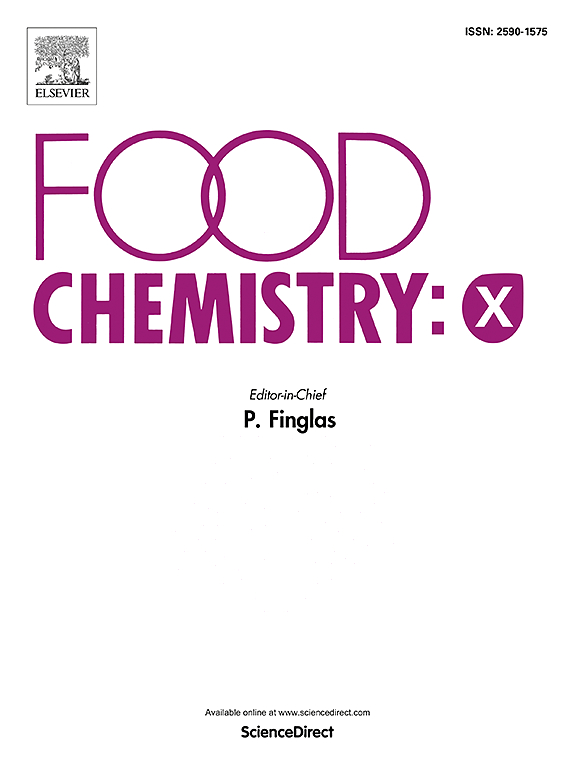
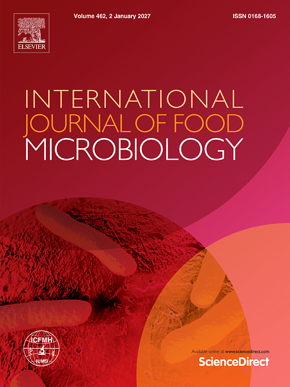
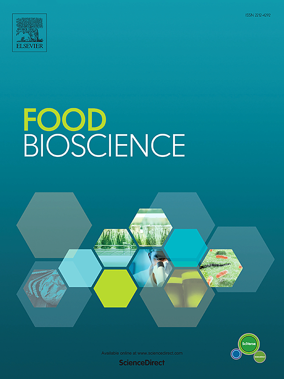
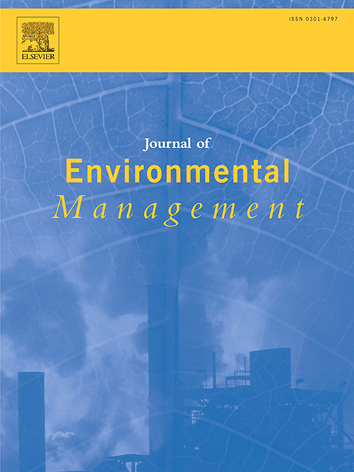
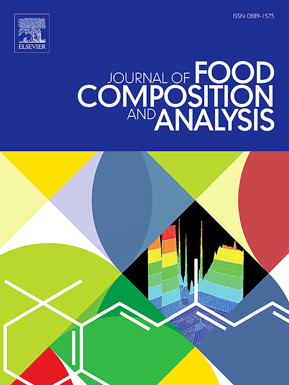
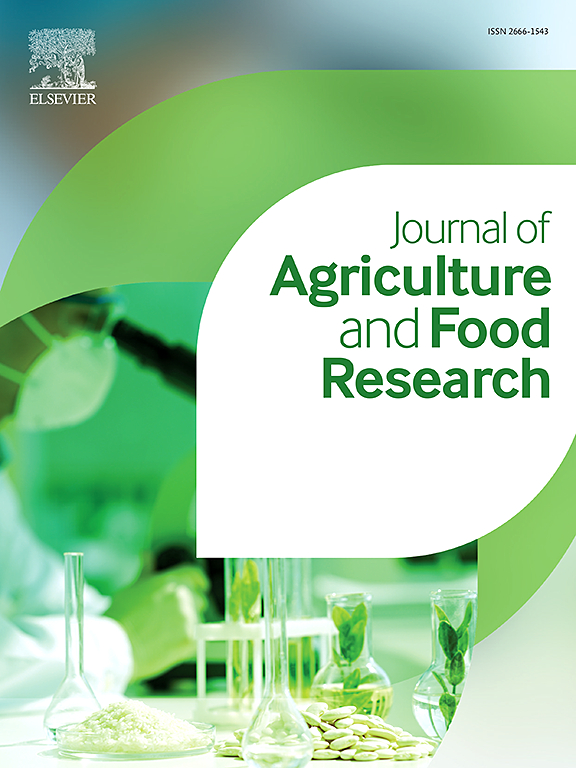
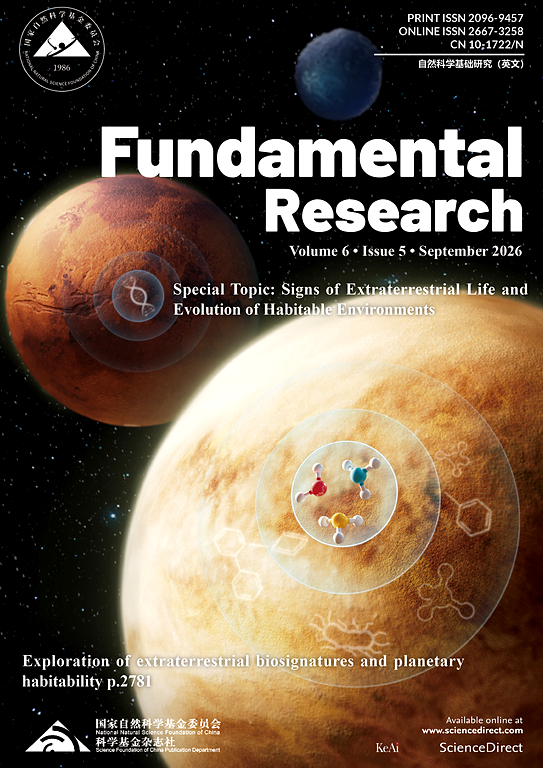
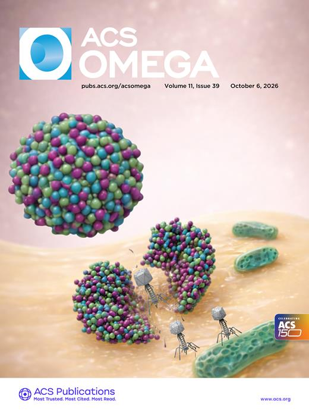
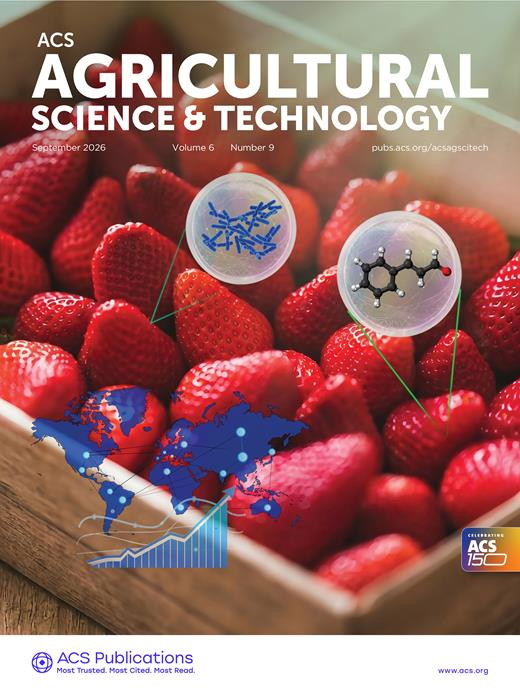
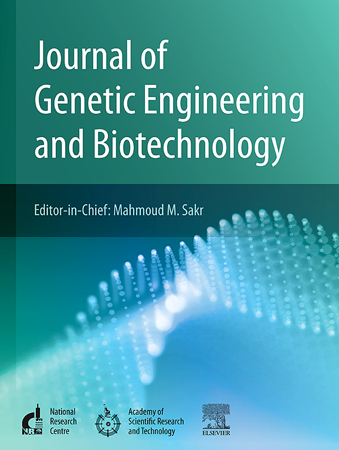

---
pagetitle: "Activities | Weitao Wang"
page-layout: full
---
::: {.activities-page}
## Conferences

::: {.conference-year}

::: {.conference-year-label}
2026
:::

::: {.conference-year-content}

**SETAC Asia-Pacific 15th Biennial Meeting**  
*Tsukuba, Japan* · Oral Presentation

**20th International Symposium on Microbial Ecology**  
*Auckland, New Zealand* · Poster Presentation

**20th National Environmental Conference for Doctoral Students**  
*Beijing, China* · Session Chair & Oral Presentation

:::

:::

::: {.conference-year}

::: {.conference-year-label}
2024
:::

::: {.conference-year-content}

**20th Annual Meeting of the US-China Carbon Consortium**  
*Qinghai, China* · Poster Presentation

**6th Academic Expert Invitation Seminar on Pesticide Residues and Quality & Safety of Agricultural Products**  
*Guangdong, China* · Oral Presentation · Outstanding Oral Presentation

:::

:::

---

## Academic Service

### Journal Peer Review

20+ peer-review reports completed for academic journals.

::: {.journal-scroll}

::: {.journal-card}
{fig-alt="Food Chemistry X journal cover"}

Food Chemistry: X
:::

::: {.journal-card}
{fig-alt="International Journal of Food Microbiology journal cover"}

International Journal of Food Microbiology
:::

::: {.journal-card}
{fig-alt="Food Bioscience journal cover"}

Food Bioscience
:::

::: {.journal-card}
{fig-alt="Journal of Environmental Management journal cover"}

Journal of Environmental Management
:::

::: {.journal-card}
{fig-alt="Journal of Food Composition and Analysis journal cover"}

Journal of Food Composition and Analysis
:::

::: {.journal-card}
{fig-alt="Journal of Agriculture and Food Research journal cover"}

Journal of Agriculture and Food Research
:::

::: {.journal-card}
{fig-alt="Fundamental Research journal cover"}

Fundamental Research
:::

::: {.journal-card}
{fig-alt="ACS Omega journal cover"}

ACS Omega
:::

::: {.journal-card}
{fig-alt="ACS Agricultural Science and Technology journal cover"}

ACS Agricultural Science & Technology
:::

::: {.journal-card}
{fig-alt="Journal of Genetic Engineering and Biotechnology journal cover"}

Journal of Genetic Engineering and Biotechnology
:::

:::

---

## Awards & Honours

::: {.conference-year}

::: {.conference-year-label}
2024
:::

::: {.conference-year-content}

**China Scholarship Council / University of Auckland Joint Scholarships**  
*China Scholarship Council*

**Thesis Writing Competition — 2nd Runner-up**  
*Hong Kong University of Science and Technology (Guangzhou)*

:::

:::

::: {.conference-year}

::: {.conference-year-label}
2022
:::

::: {.conference-year-content}

**University of Hong Kong: Graduated with Distinction**  
*University of Hong Kong*

:::

:::

::: {.conference-year}

::: {.conference-year-label}
2021
:::

::: {.conference-year-content}

**Beijing University Student Biology Competition — 1st Award**  
*Beijing Municipal Education Commission*

**Outstanding Graduate of Beijing**  
*Beijing Municipal Education Commission*

**Merit Student of BUCT**  
*Beijing University of Chemical Technology*

:::
:::