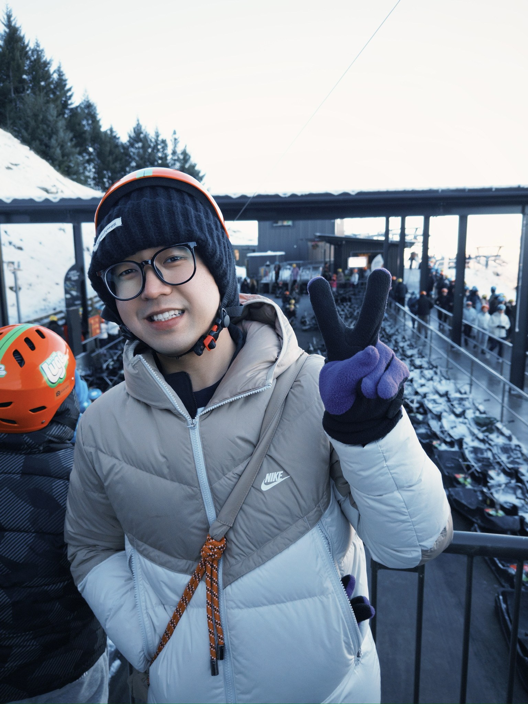

---
pagetitle: "Home | Weitao Wang"
page-layout: full
---

::: {.hero}

::: {.hero-copy}

::: {.eyebrow}
PHD RESEARCHER · UNIVERSITY OF AUCKLAND
:::

# Hi, I'm Weitao.

I am a PhD researcher in Environmental Science at the University of Auckland, and interested in **omics**, **(bio)pesticides**, **food safety** and **sustainable agriculture**.

This is a space for my research, experiences, and little moments of life along the way.

:::

::: {.hero-art}

  

  

  

:::

:::

## Explore

::: {.explore-grid}

::: {.explore-card}

### [Projects →](projects/index.qmd)

Explore my research projects, from field studies to environmental fate experiments.

:::

::: {.explore-card}

### [Publications →](publications.qmd)

A collection of my published research and academic contributions.

:::

::: {.explore-card}

### [Academic Activities →](activities.qmd)

Conferences, presentations, peer review, and academic recognition.

:::

::: {.explore-card}

### [Life →](life/index.qmd)

Travel, photography, and little moments beyond research.

:::

:::
