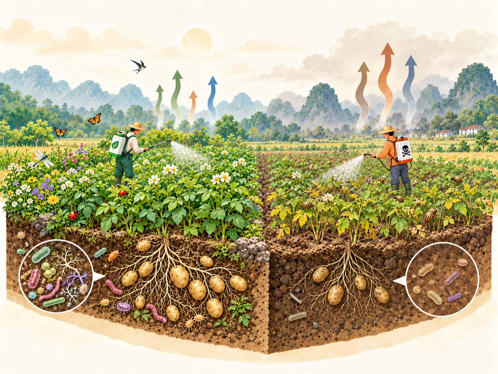
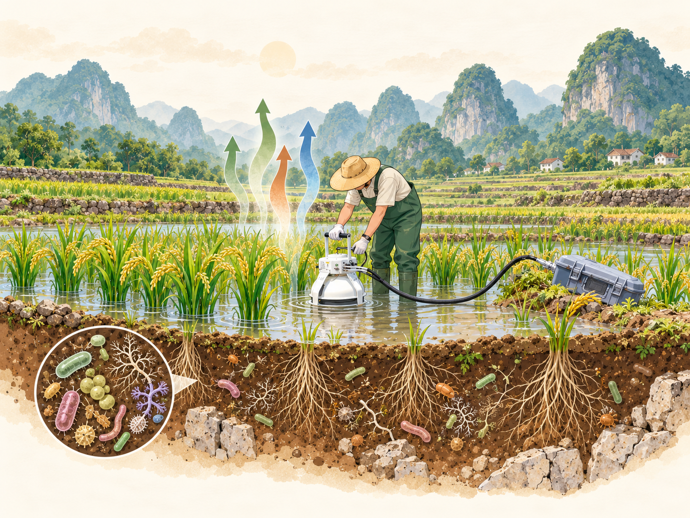
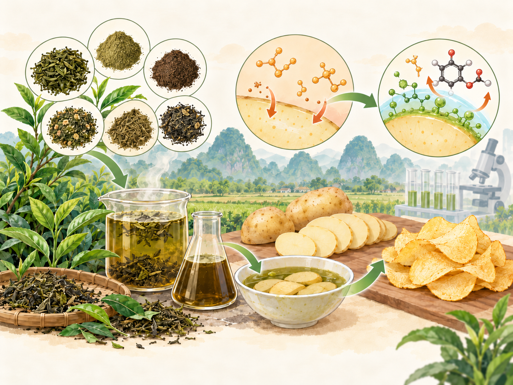
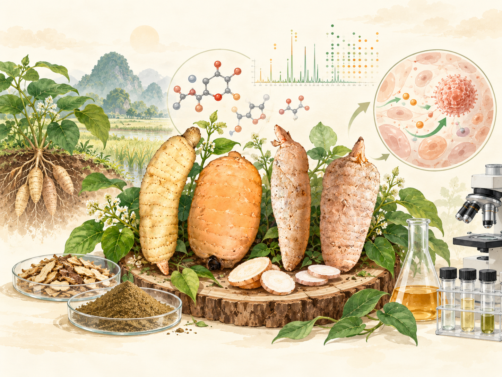

---
pagetitle: "Projects | Weitao Wang"
page-layout: full
---

::: {.projects-page}

::: {.project-block .project-reverse}

::: {.project-copy}

01

## Biopesticides vs. Synthetic Pesticides

The widespread use of synthetic pesticides has raised growing concerns about their environmental impacts. Biopesticides offer promising alternatives, while their evaluation has largely focused on pest control efficacy rather than broader agricultural and ecological outcomes. Our research found that biopesticides generally performed slightly less well in pest control and yield improvement, while showing potential environmental benefits. However, **natural does not necessarily mean safe**. We therefore investigate their non-target effects, including impacts on crop quality, soil microbiomes, and environmental fate.

:::

::: {.project-image}

:::

:::

::: {.project-block}

::: {.project-copy}

02

## Soil–Atmosphere Carbon Exchange in Karst Rice Paddies

Karst landscapes feature complex carbon cycling shaped by their distinctive geology, hydrology, and agricultural management. However, soil–atmosphere carbon exchanges in karst rice paddies remain poorly understood. To address this gap, we monitored carbon fluxes (CO₂ and CH₄) across one growing season in two rice fields under different management practices. By integrating *in situ* measurements with soil properties and microbial community analyses, we investigated the temporal dynamics and environmental drivers of carbon exchange in these agricultural ecosystems.

:::

::: {.project-image}

:::

:::

::: {.project-block .project-reverse}

::: {.project-copy}

03

## Mitigation of Harmful Compounds in Food Processing

Harmful compounds can form during thermal food processing, posing potential risks to human health. Although phenolic-rich extracts have shown promise in reducing their formation, the effectiveness of different tea extracts, particularly those derived from underutilised materials, remains insufficiently explored. Our research evaluated extracts from green tea dust, aged green tea, yellow tea, white tea, oolong tea, and black tea as strategies to mitigate multiple harmful compounds in fried potato chips and baked oysters, while considering food quality.

:::

::: {.project-image}

:::

:::

::: {.project-block}

::: {.project-copy}

04

## Bioactive Compounds in Chinese Medicine

Traditional Chinese medicinal plants contain diverse bioactive compounds with potential therapeutic properties, yet the chemical constituents underlying their biological activities remain incompletely characterised. Using untargeted metabolomics and complementary computational approaches, our research explores their metabolic diversity, identifies candidate bioactive compounds, and investigates potential mechanisms of action. These findings provide a foundation for understanding the medicinal potential of natural products, including their possible relevance to inflammation-related conditions.

:::

::: {.project-image}

:::

:::

:::
